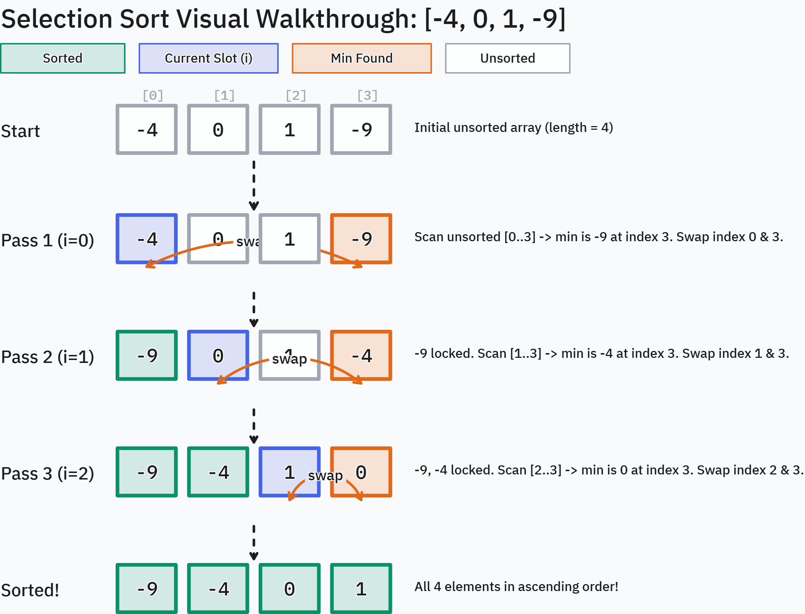

# Selection Sort Assignment

An implementation of the **Selection Sort** algorithm in Python ($O(n^2)$ time complexity, $O(1)$ auxiliary space), accompanied by a step-by-step visual diagram and a `pytest` test suite.

## How Selection Sort Works (List of Length 4)

Starting with `[-4, 0, 1, -9]`, Selection Sort divides the list into a **sorted** left portion and an **unsorted** right portion. On each pass, it scans the unsorted portion for the smallest value and swaps it into the next sorted position:




*Source diagram: [`selection_sort.tldr`](./my-app/public/selection_sort.tldr)*

## Project Files

- `selection_sort.py` — In-place Selection Sort implementation with step-by-step console output.
- `test_selection_sort.py` — Unit tests verifying sorted results and printed steps using `pytest`.
- `selection_sort.tldr` & `selection_sort.png` — Visual walkthrough diagram and exported image.

## Running the Tests

```bash
pytest -v